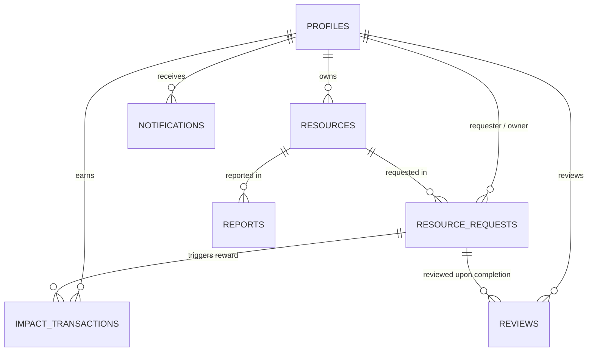

# LoopSpace — Comprehensive Viva & Assessment Guide
## Smart Campus Resource Sharing & Circular Economy Platform

This document is prepared specifically to help developers, students, and evaluators understand and present every technical and architectural facet of **LoopSpace** during a project defense, code walkthrough, or university viva.

---

## 1. Project Overview & Problem Statement

- **Tagline:** *Share More. Waste Less. Build Together.*
- **Core Concept:** LoopSpace is a peer-to-peer campus resource-sharing and circular economy platform. It allows college students to lend, borrow, exchange, or donate academic items (textbooks, graphing calculators, lab coats, sports equipment, electronics) rather than purchasing brand-new single-use supplies.
- **Key Differentiation:** Unlike static bulletin boards or generic social media marketplaces, LoopSpace features:
  1. A **Multi-Attribute Need–Offer Matching Engine** that scores compatibility deterministically without paid AI APIs.
  2. A **Defensible Loop Impact Score** that rewards verified sharing and calculates avoided carbon (kg CO2) and financial savings ($).
  3. A **Multi-Stage Request Lifecycle** enforcing business rules in both frontend and database.
  4. An **Automated Google Sheets Synchronization** using server-side Google Cloud service accounts.

---

## 2. Technology Stack & Architectural Justifications

| Layer | Technology | Engineering Rationale |
|---|---|---|
| **Frontend Framework** | **Next.js 14 (App Router)** | Server Components for instant initial paint, file-system routing, and built-in API Route Handlers. |
| **Language** | **TypeScript** | Strict compile-time type safety preventing runtime null/undefined errors across models. |
| **Styling** | **Tailwind CSS** | Design token consistency, utility classes, dark/light theme switching with custom forest palette. |
| **Icons & UI** | **Lucide React** | Featherweight tree-shakeable SVG icons. |
| **Database & Auth** | **Supabase (PostgreSQL)** | Managed relational database, native Row-Level Security (RLS), trigger functions, and JWT Auth. |
| **Storage** | **Supabase Storage** | S3-compatible bucket for user-uploaded resource photos with size/type validation. |
| **Spreadsheets** | **Google Sheets API v4** | Secure backend report exporting with JWT service accounts for faculty and administrative oversight. |
| **Charts & Analytics**| **Recharts** | Declarative responsive SVG bar and donut charts for campus activity trends. |

---

## 3. Database Architecture & Schema Design

The database schema (`supabase/schema.sql`) consists of **8 interconnected relational tables**:

### Table Breakdown:
1. `profiles`: Primary key references Supabase `auth.users(id)` with cascade on delete. Contains `impact_points`, `role` (`user`, `moderator`, `admin`), `is_phone_public`, and college fields.
2. `resources`: Primary key `gen_random_uuid()`, category enum, condition enum, sharing type enum, availability date ranges (`available_until >= available_from`), image arrays, pickup location.
3. `resource_requests`: Manages request lifecycle (`pending` -> `accepted` -> `ready_for_pickup` -> `borrowed` -> `return_requested` -> `returned` -> `completed`). Enforces `requester_id <> owner_id`.
4. `notifications`: In-app alert queue linking directly to affected items.
5. `impact_transactions`: Records point allocations. Features **unique composite constraint** `(user_id, request_id, activity_type)` to mathematically guarantee **no double rewards**.
6. `reviews`: 1–5 star ratings and comments between transaction participants.
7. `reports`: Abuse and prohibited listing reports submitted by campus members for admin review.
8. `admin_audit_logs`: Audit trail tracking privileged administrative actions.

---

## 4. Security Architecture & Least Privilege

- **Row Level Security (RLS):**
  - Permitted profile fields can only be edited by their owner. Users **cannot** modify their own `impact_points` or escalate their `role` to `admin` in update queries.
  - Resource requests are readable **only** by the requester, owner, or verified administrator (`auth.uid() = requester_id or auth.uid() = owner_id or is_admin()`).
- **Server-Side Credential Isolation:**
  - Google Cloud service account private keys (`GOOGLE_PRIVATE_KEY`) and Supabase service-role keys are kept strictly in server-side environment variables. They are never imported or referenced in client-rendered components.
- **Self-Request Prevention:**
  - Enforced in the database constraint `check_requester_not_owner` and validated in client forms.

---

## 5. Creative Feature Deep-Dive

### A. Need–Offer Matching Engine
- **How it works without paid AI APIs:**
  1. **Tokenization & Stopword Elimination:** Strips punctuation, lowercases terms, removes generic English stopwords (`the`, `for`, `need`, `please`).
  2. **Category Exact Match (35 pts):** Awards full marks if the search targets the item's academic category.
  3. **Keyword & Title Overlap (30 pts):** Weighted semantic overlap between query keywords and candidate titles (70% weight) and descriptions (30% weight).
  4. **Availability Window Alignment (15 pts):** Verifies that the requested borrowing window falls within the resource's active availability window.
  5. **Condition Suitability (10 pts):** Matches preference for New, Like New, or Good condition.
  6. **Campus Zone Proximity (10 pts):** Evaluates campus pickup location proximity (e.g., Library vs. Engineering Quad).
  7. **Tier Categorization:**
     - `>= 75%`: **Excellent Match**
     - `50% - 74%`: **Good Match**
     - `25% - 49%`: **Possible Match**

### B. Defensible Loop Impact Score
- **Points Structure:**
  - Item Loan: `+20 pts`
  - Permanent Donation: `+25 pts`
  - Resource Swap / Exchange: `+20 pts`
  - Need Fulfillment: `+10 pts`
- **Avoided Carbon & Financial Savings Benchmarks:**
  - Calculated based on standard Life Cycle Assessment (LCA) data:
    - Textbooks: `2.7 kg CO2` avoided, `~$45` saved.
    - Graphing Calculators / Electronics: `14.2 kg CO2` avoided, `~$70` saved.
    - Lab Equipment: `11.5 kg CO2` avoided, `~$85` saved.
  - Transparently marked as estimates with published methodology notes.

---

## 6. Common Viva Questions & High-Scoring Answers

### Q1: "Why did you build your own matching engine instead of calling OpenAI or Gemini?"
> **Answer:** "In a real campus environment, student platforms operate under tight budget constraints where paid per-token LLM APIs introduce latency, recurring operational costs, and unpredictability. By building a deterministic multi-attribute scoring model in TypeScript, we achieve zero marginal cost, microsecond response times, and 100% transparent scoring breakdowns where the student can see exactly why a result scored 85%."

### Q2: "How do you prevent a user from claiming impact points multiple times for the same exchange?"
> **Answer:** "We solve this at the database layer using a composite unique constraint on `impact_transactions(user_id, request_id, activity_type)`. If a malicious client tries to call the reward routine twice, the PostgreSQL engine aborts the transaction with a unique constraint violation."

### Q3: "How does the application function if Supabase or Google Sheets credentials are not yet configured?"
> **Answer:** "The application uses an enterprise-grade graceful degradation pattern. It detects whether live credentials are present in the environment; if missing, it seamlessly initializes in Interactive Demo Mode with pre-seeded campus personas (Alex Chen, Priya Patel, Marcus Johnson, Admin Elena Rodriguez). All workflows—matching, request lifecycles, and dashboard charts—function identically, while Google Sheets export offers a downloadable CSV preview alongside clear setup instructions."

### Q4: "How does Google Sheets integration maintain security?"
> **Answer:** "The integration uses Google Service Account JWT authentication handled exclusively inside a Next.js App Router Route Handler (`/api/export-sheets`). The private key is never passed to the browser, and the endpoint enforces role-based access before batching data to the 4 configured spreadsheet tabs."
